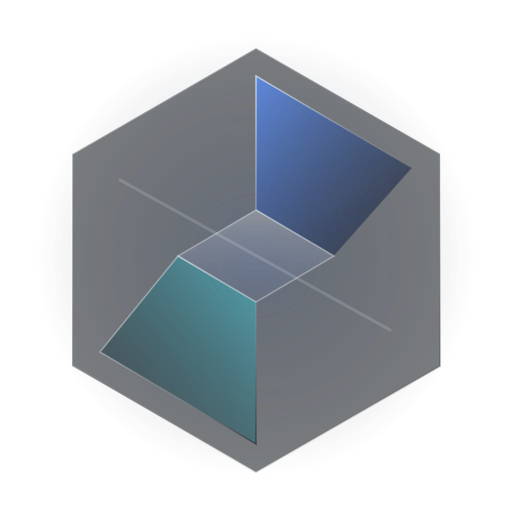

<div align="center">
  
  <h1>Sydra OS</h1>
  <p><strong>A professional glass desktop for people who build things and play games.</strong></p>
  <p>
    <a href="#quick-start">Quick Start</a> •
    <a href="#desktop-architecture">Desktop</a> •
    <a href="#features">Features</a> •
    <a href="#releases">Releases</a> •
    <a href="docs/MASTER_PLAN.md">Master Plan 2.0</a>
  </p>
</div>

---

## Overview

**Sydra OS** is an Arch-based Linux distribution engineered for developers, systems builders, and gamers. Built around a refined **Sydra Glass Pro** design language, it pairs System76’s Rust-based **COSMIC** desktop with native frosted glass translucency, out-of-the-box hybrid GPU orchestration (NVIDIA RTX 50 series & PRIME offload), an automated Calamares installer, and a zero-friction development stack.

> *KDE Plasma 6 is maintained as an optional edition in [Appendix K of the Master Plan](docs/MASTER_PLAN.md#appendix-k--optional-kde-plasma-edition-start-only-after-v01-ships).*

---

## Brand Palette

| Role | Hex | Usage |
|---|---|---|
| **Base / Graphite** | `#12141A` | Dark frosted glass tint, window backgrounds, login surfaces |
| **Primary Accent** | `#5B8DEF` | System accent, selection highlights, focus rings, `NATIVE` badges |
| **Secondary Accent** | `#4FB3BF` | Midnight highlights, terminal elements, telemetry charts |
| **Text** | `#F2F4F8` | High-contrast WCAG AA compliant typography (Inter & JetBrains Mono) |

---

## Features

- **COSMIC Epoch 1 Desktop**:
  - Native Rust-based compositor (`cosmic-comp`) and shell (`cosmic-panel`, `cosmic-launcher`, `cosmic-app-library`).
  - Native Frosted Glass translucency on panels, docks, and windows with blur-behind rendering.
  - Floating bottom dock and thin status top panel with active workspaces.
  - Standardized styling across GTK 3/4 (via `adw-gtk-theme`) and Qt 6 (via `qt6ct` and `kvantum`).
- **Gamer Experience**:
  - Preconfigured Steam, Proton-GE, Lutris, Gamemode, MangoHud, and Gamescope.
  - Automatic GPU detection via `siddha-gpu-setup` supporting modern NVIDIA GPUs (including RTX 50 series open modules) and Intel/NVIDIA hybrid laptops via `prime-run`.
  - Curated offline-first native game catalog with verified compatibility badges.
- **Developer Workstation**:
  - Zsh with Starship prompt, `zoxide`, `fzf`, `eza`, `bat`, and `fastfetch`.
  - Compilers & Toolchains: `clang`, `gcc`, `cmake`, `ninja`, `gdb`, Python (`uv`), Node.js, Go, and `rustup`.
  - Rootless container virtualization: `podman`, `distrobox`, and `docker`.
  - Interactive CLI environment setup with `siddha-dev`.
- **System Hardening & Resilient Rolling Core**:
  - Arch Linux rolling base with default Btrfs subvolumes (`@`, `@home`, `@log`, `@pkg`, `@snapshots`).
  - Automated Snapper snapshots on pacman operations (`snap-pac`) bootable directly from GRUB (`grub-btrfs`).
  - Dynamic ZRAM swap allocation and desktop-tuned gaming sysctl rules (`99-siddha.conf`).

---

## Desktop Architecture

```
sydra-os/
├── assets/logo/             # Official Sydra vector logo & deterministic variants (16-512px)
├── assets/wallpapers/       # Sydra Obsidian Waves & procedural wallpapers
├── catalog/                 # 45+ curated native Linux games catalog
├── docs/                    # Master Plan 2.0, Decisions, Progress log, COSMIC Theming guide
├── iso/profile/             # Customized mkarchiso profile
│   ├── airootfs/            # Live overlay (greetd autologin, installer, shell skel)
│   └── packages.x86_64      # Package manifest generated from packages/*.txt
├── packages/                # Modular package lists (base, desktop, dev, gaming, etc.)
├── repo/pkgbuilds/          # Custom Sydra packages (installer, branding, theme, dev, GPU tools)
├── tokens/glass.json        # Design token specification
└── tools/glassgen.py        # Token compiler & theme generator for COSMIC, GTK, Qt, and Terminal
```

---

## Releases & Checksums

| ISO Image | Architecture | Desktop | SHA-256 Checksum |
|---|---|---|---|
| `sydra-os-2026.11.19-x86_64.iso` | x86_64 (UEFI / BIOS) | **COSMIC** (Primary) | `d38e61ead9bdc5a04cb908ae3dae1095cae7358353734a1422e0b45cf1d201f8` |

---

## Quick Start (Building the ISO)

Building the ISO requires an Arch Linux host (Laptop A: EndeavourOS) with `sudo` access and at least 25 GB free disk space:

```bash
# 1. Install toolchain prerequisites
sudo pacman -Syu --needed archiso devtools git base-devel qemu-desktop \
  edk2-ovmf squashfs-tools libisoburn mtools dosfstools rsync reflector \
  shellcheck jq python btrfs-progs gnupg

# 2. Clone repository
git clone https://github.com/ED-TECH-0/sydra-os.git
cd sydra-os

# 3. Verify environment and build dependencies
make check

# 4. Generate package manifests and build ISO
make packages
make iso

# 5. Test in QEMU
make qemu-uefi
```

### Flashing to Bootable USB

To flash to a USB drive (safeguarded against non-removable or system disks):

```bash
sudo scripts/flash-usb.sh build/out/sydra-os-2026.11.19-x86_64.iso /dev/sdX
```

---

## Documentation

- [Master Plan 2.0](docs/MASTER_PLAN.md)
- [COSMIC Theming Guide](docs/COSMIC_THEMING.md)
- [Architecture Decisions Log](docs/DECISIONS.md)
- [Task Progress Log](docs/PROGRESS.md)
- [Licenses](docs/LICENSES.md)

---

## License

Original Sydra OS code is licensed under the [GNU General Public License v3.0](LICENSE).
Third-party component licenses and attributions are documented in [docs/LICENSES.md](docs/LICENSES.md).
